<p align="center">
  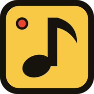
</p>

<h1 align="center">KEYCHANGE</h1>

<p align="center">
  <strong>Play your words loud.</strong><br>
  Turn any MIDI piano into a keyboard.
</p>

<p align="center">
  <a href="https://abhinav-prabhakar.github.io/KeyChange/"></a>
  
  
  
</p>

<a href="https://abhinav-prabhakar.github.io/KeyChange/">
  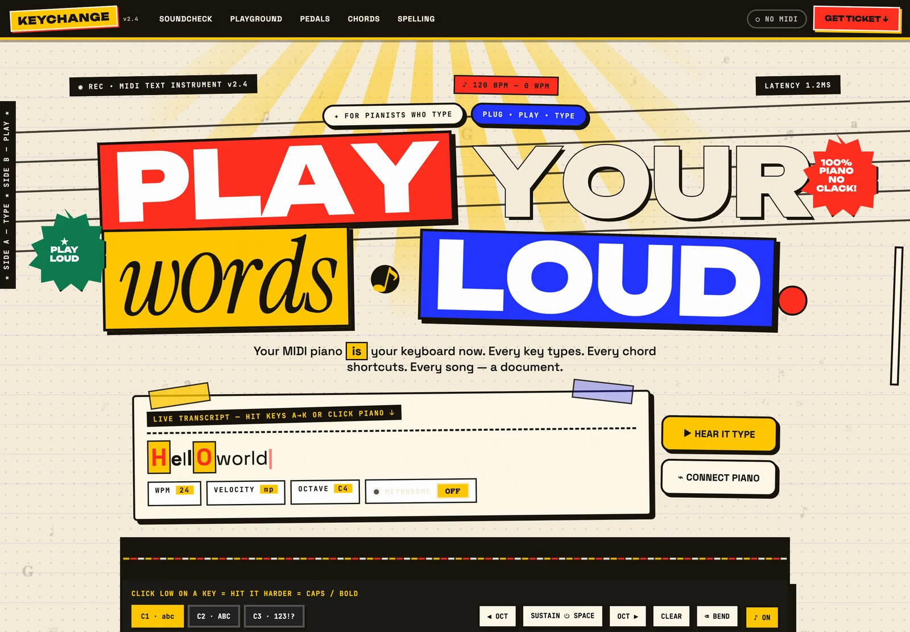
</a>

<p align="center"><sub><a href="https://abhinav-prabhakar.github.io/KeyChange/"><b>▶ Open the live stage</b></a> · click a key, or hit A–K, and it types.</sub></p>

> **Typing was never meant to clack. It was meant to sing.** So we tuned every letter, gave punctuation rhythm, and turned QWERTY into an instrument. Every key types. Every chord shortcuts. Every song — a document.

**KeyChange** is a MIDI text instrument. Plug in a piano, play a letter, and watch it land in a live transcript. Hit a key harder and it gets **bolder**; tap soft and it turns *italic*. Sustain holds your spaces, three-note chords fire shortcuts, and the staff snaps sloppy playing into perfect spelling.

This repository holds both halves: the **landing page** — one hand-built page that is also a working toy — and the **native app**, a Rust + GPUI instrument that talks to real MIDI hardware and puts the entire instrument on a single screen.

---

## The instrument

| On the keys | What happens |
|---|---|
| 🎹 **Plug in** | Any USB MIDI keyboard. Web MIDI, no drivers, no install. |
| 🎚 **Velocity → emphasis** | Soft = *italic*. Medium = plain. Slam = **bold**. Fortissimo = highlight. |
| 🦶 **Sustain → space** | Hold the pedal, hold the space. Legato typing with no gaps. |
| 🎼 **Staff → page** | Notes snap onto lines and become sentences. Bar lines are paragraphs. |
| 🎲 **Quantize → autocorrect** | Sloppy hands, perfect spelling. `teh` becomes `the` in real time. |
| ⌨️ **QWERTY fallback** | No piano? A–K still plays the on-screen keys, so the page works everywhere. |

---

## The native app

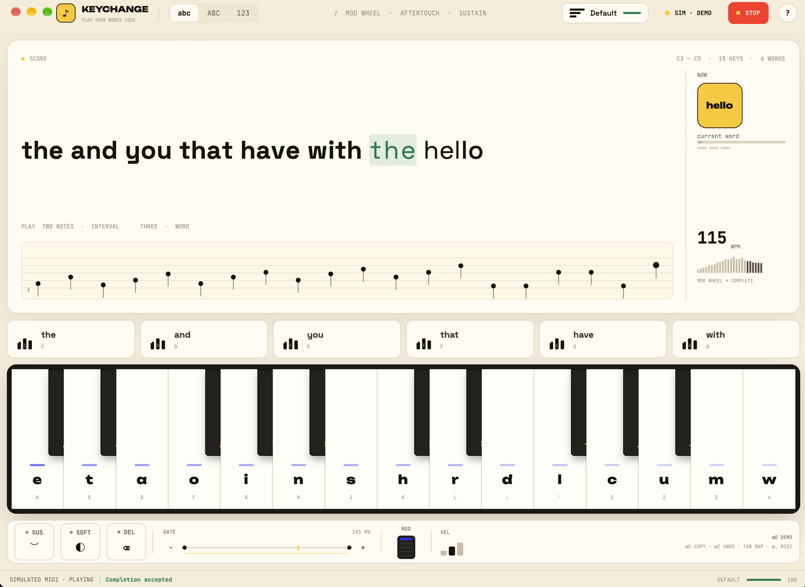

The app is the same instrument with the theatre turned down: one calm screen,
real MIDI input, and no browser in the middle. It is written in **Rust** with
**GPUI** (the renderer behind Zed) and `midir`, so it starts instantly, runs
offline, and reads any class-compliant MIDI keyboard.

<p align="center">
  <a href="https://github.com/Abhinav-Prabhakar/KeyChange/releases/latest"></a>
</p>

Open the DMG, drag **KeyChange** into Applications, and play. First launch needs
right-click → **Open** because the build is ad-hoc signed, not notarised yet.

```bash
cd app
cargo run          # development build, ⌘D plays the simulation
make app           # KeyChange.app with icon
make dmg           # drag-to-Applications disk image
cargo test         # 54 tests over the engine, MIDI and settings
```

Everything lives in one window: the transcript and staff, six word-chord pads,
a fifteen-key piano with live heat strips, and a deck for sustain, soft,
sostenuto, gate, mod wheel and velocity. The map (**Tab**) and gesture
reference (**/**) are overlays you can ignore; playing never needs them.

- **No hardware?** **⌘D** runs a simulated performance through the exact same
  MIDI byte parser as a real piano.
- **No mouse?** The whole instrument is playable from the computer keyboard.
- **No clutter?** Numbers stay under hover; the screen is bars, keys and dots
  until you ask for detail.
- **Your pedals, your numbers.** **⌘,** opens MIDI Learn; move a pedal and the
  app captures its CC. Layouts, velocity, gate and CCs survive a restart.
- **A real app.** Proper icon, `KeyChange.app` bundle, and a drag-to-install DMG.

Read [`app/README.md`](app/README.md) for the full gesture map, shortcuts,
profile scoring and architecture.

---

## Inside the instrument

<table>
<tr>
<td width="50%">
  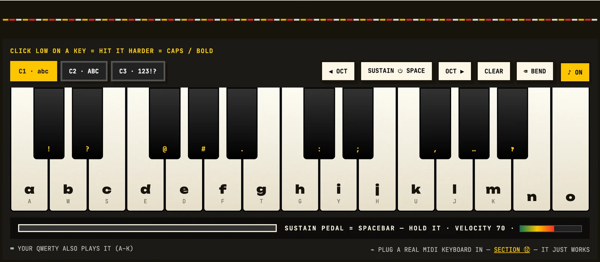
  <br><sub><b>15 keys, three layers.</b> C1 = abc, C2 = ABC, C3 = 123!?. Click low on a key to hit it harder.</sub>
</td>
<td width="50%">
  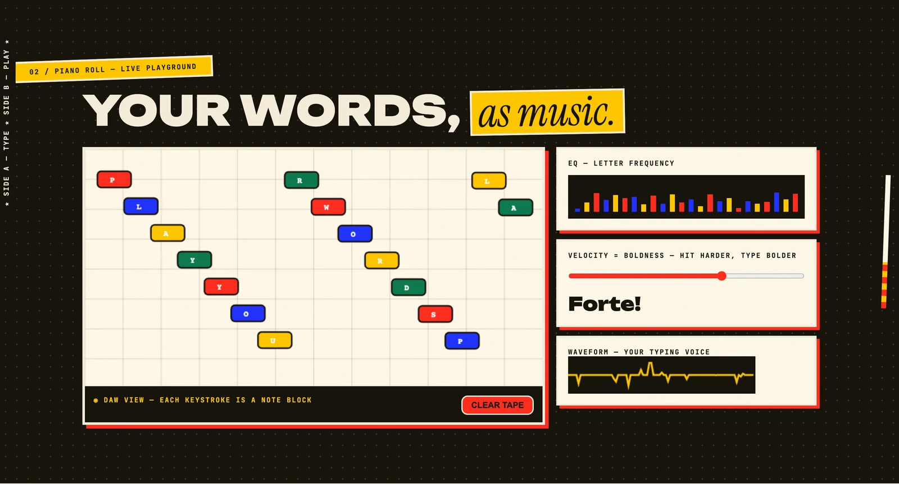
  <br><sub><b>Piano roll.</b> Every keystroke becomes a note block. EQ and waveform show the shape of your typing.</sub>
</td>
</tr>
<tr>
<td>
  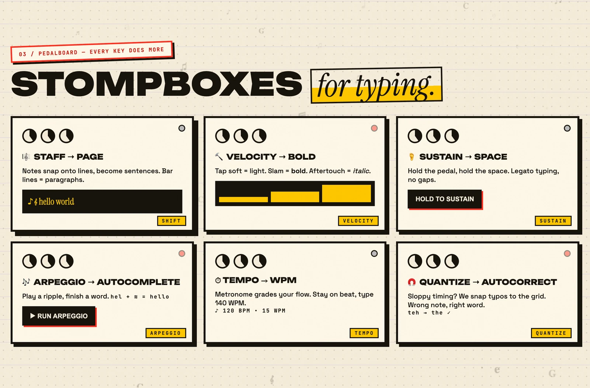
  <br><sub><b>Pedalboard.</b> Six stompboxes, six ways to type better. Each one is interactive.</sub>
</td>
<td>
  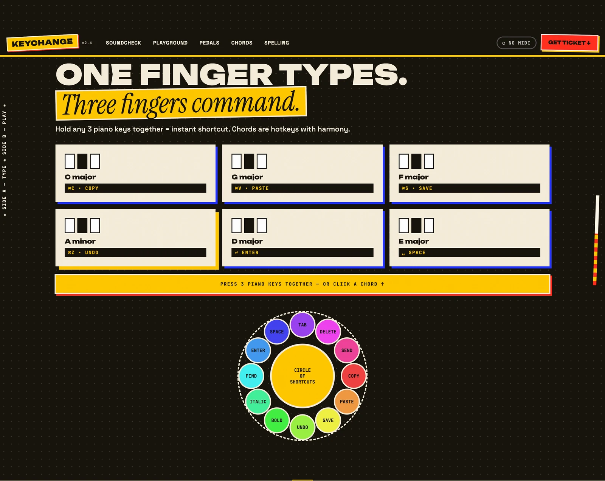
  <br><sub><b>Chords as shortcuts.</b> Hold any three keys for copy, paste, save, undo. Click a card to hear it.</sub>
</td>
</tr>
<tr>
<td>
  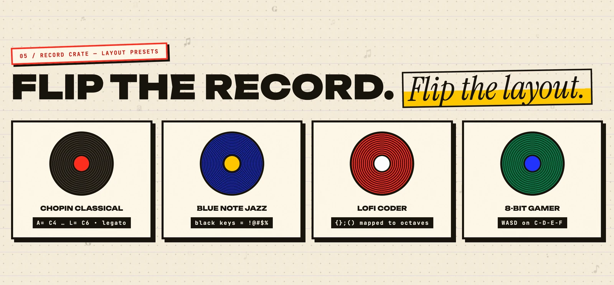
  <br><sub><b>Record crate.</b> Flip the record, flip the layout. Four presets with very different hands.</sub>
</td>
<td>
  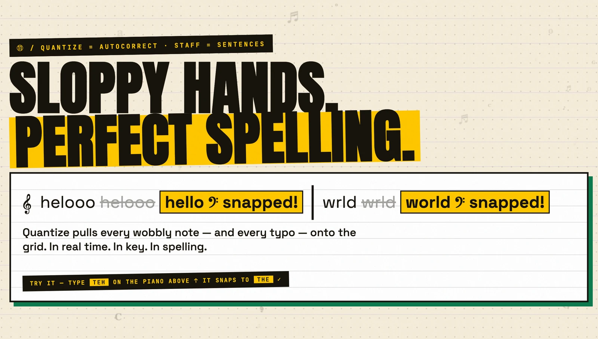
  <br><sub><b>Sloppy hands, perfect spelling.</b> Type TEH on the piano and watch it snap to THE.</sub>
</td>
</tr>
<tr>
<td>
  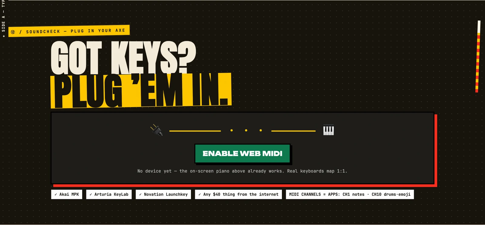
  <br><sub><b>Soundcheck.</b> One button connects a real keyboard. Akai, Arturia, Novation, or any $40 thing.</sub>
</td>
<td>
  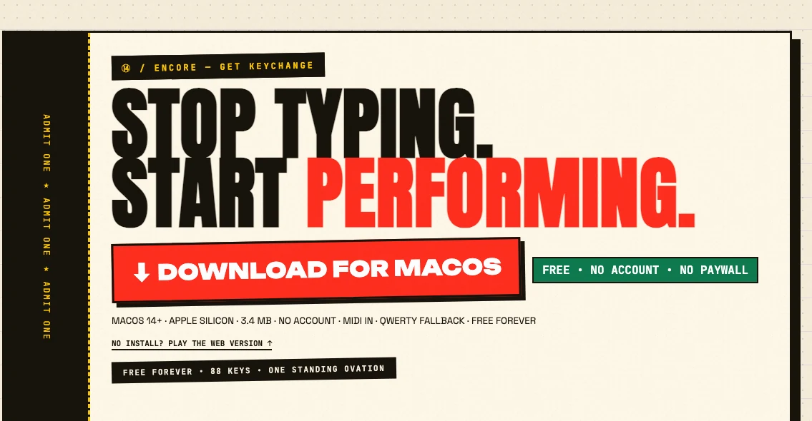
  <br><sub><b>Encore.</b> Free forever. No account. No paywall. One standing ovation.</sub>
</td>
</tr>
</table>

<p align="center">
  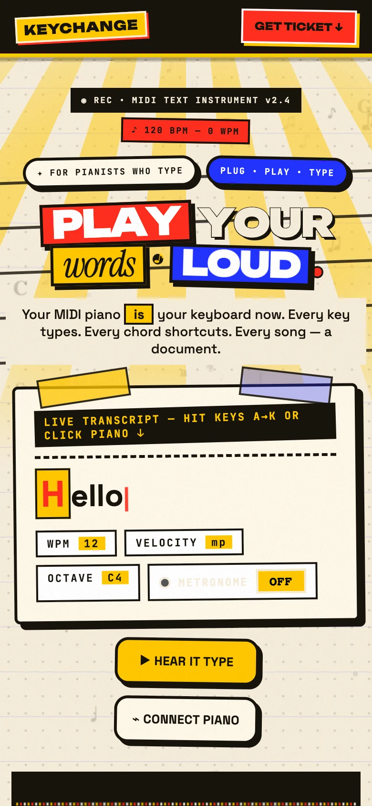
  <br><sub><b>Pocket-sized poster.</b> The whole stage reflows down to 320px with the same loud type.</sub>
</p>

---

## Play it with your hands

| Input | Action |
|---|---|
| `A S D F G H J K L ;` | White keys |
| `W E T Y U` | Black keys (symbols) |
| `Z` / `X` | Octave down / up |
| `Space` | Sustain — types a space |
| `Backspace` | Delete with a bend |
| Click a key | Play it; click **low** on the key for a harder hit |

Chrome or Edge plus HTTPS is required for real **Web MIDI**. The on-screen piano and QWERTY work in every modern browser.

---

## Run the page locally

No package manager, no bundler, no build step.

```bash
git clone https://github.com/Abhinav-Prabhakar/KeyChange.git
cd KeyChange
python3 -m http.server 8099
```

Then open <http://localhost:8099>. That's it.

---

## What's in the repo

```text
KeyChange/
├── index.html          One page. The whole gig.
├── style.css           Risograph design system, layouts, responsive rules.
├── design.md           The written design system: tokens, components, audio, rules.
├── app.js              Sampled piano, Web MIDI, canvas piano roll, interactions.
├── app/                Native instrument — Rust, GPUI, midir, app icon, DMG scripts.
├── favicon.svg         The mark, plus .ico / 32 / 192 / 512 / touch-icon exports.
├── site.webmanifest    Installable app metadata.
├── robots.txt          Crawl rules.
├── sitemap.xml         One URL, zero surprises.
├── LICENSE             MIT.
├── .nojekyll           Serve the repo as-is on GitHub Pages.
└── assets/
    ├── og.png          The 1200×630 social card.
    ├── og-card.html    The hand-built source for that card.
    ├── audio/piano/    30 Salamander grand-piano samples (CC BY 3.0).
    └── *.webp          README screenshots, straight from the live page.
```

**Stack:** semantic HTML, hand-written CSS, vanilla JavaScript, Canvas 2D, Web Audio API, Web MIDI API, Google Fonts. The piano voice is a **Salamander Grand Piano V3** sampler (one sample every three semitones) with velocity-shaped filters, stereo spread, a convolution room, a master compressor and a measured tuning correction — plus an additive fallback if the samples can't load. The middle of the keyboard loads first; outer octaves arrive when the page is idle. No frameworks, no trackers, no cookies.

**Native stack:** Rust, GPUI, `midir`, bundled OFL fonts. No Electron, no WebView, no runtime to install.

**Polish included:** canonical URL, Open Graph and Twitter cards, JSON-LD `SoftwareApplication` schema, a full favicon family, web manifest, sitemap, `robots.txt`, and `prefers-*`-friendly type fallbacks.

**Design system:** everything above is written down in [`design.md`](design.md) — palette and contrast pairs, type scale, spacing, z-index layers, every component, the piano map, the audio graph, motion and accessibility rules, plus checklists and known gaps. Read it before adding a section or a component; if you change the look or behaviour, update it in the same commit.

---

## Deploy

The site is served by **GitHub Pages** from the `main` branch root:

**<https://abhinav-prabhakar.github.io/KeyChange/>**

To publish an update:

```bash
git add -A
git commit -m "Update the stage"
git push
```

GitHub Pages picks up the push in about a minute.

---

## What's next

- [x] Landing page — the playable poster you're looking at
- [x] **The KeyChange app** — macOS, Rust + GPUI, real MIDI in, QWERTY fallback, simulated player
- [x] Saved profiles — custom layouts, velocity, gate and CCs survive a restart
- [x] MIDI Learn — teach the app any sustain pedal or expression knob
- [ ] Notarised release — first launch without the right-click dance
- [ ] Per-key character picker — remap letters as well as controls
- [ ] Accessibility pass: full screen-reader pass and configurable targets

The native app lives in [`app/`](app/) next to the stage.

---

<p align="center">
  
  <br>
  <sub><b>© 2026 KEYCHANGE — PLAY YOUR WORDS</b><br>
  Made at 440Hz · <i>ppp → fff</i> · zero clack · MIT</sub>
</p>
