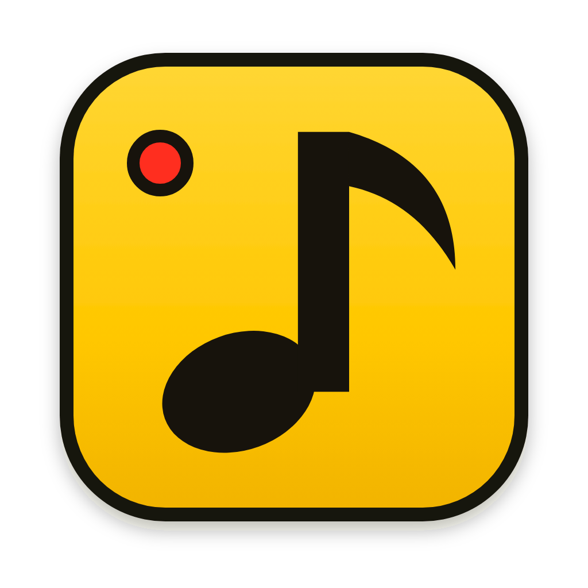
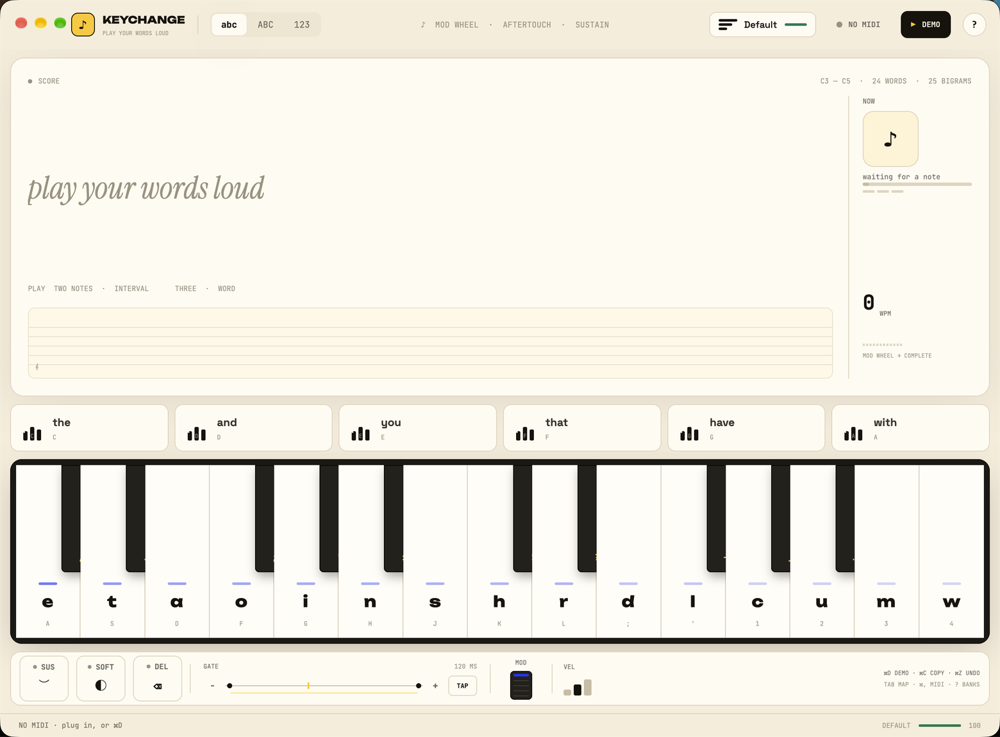
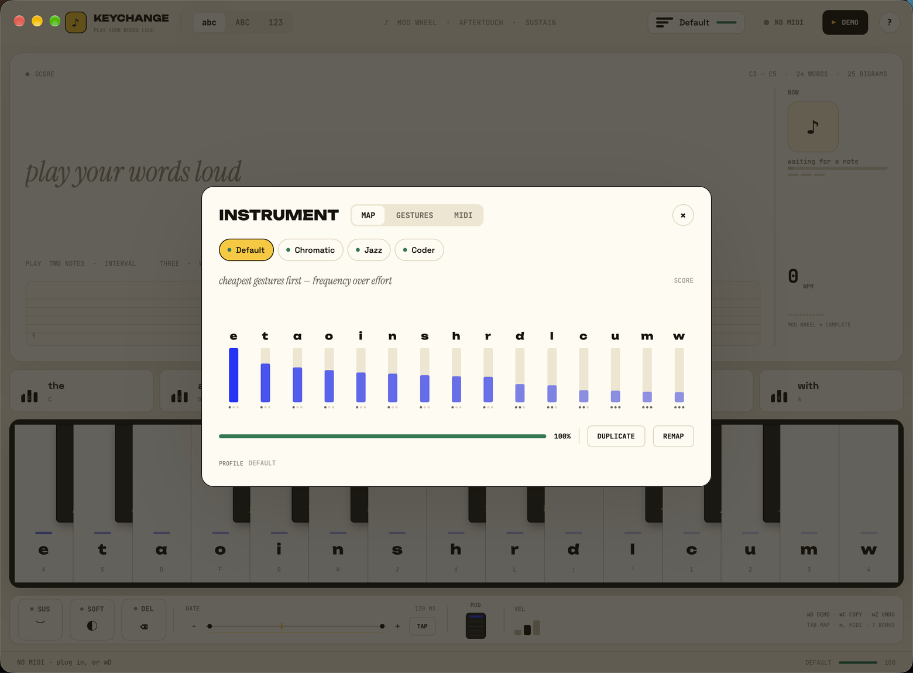
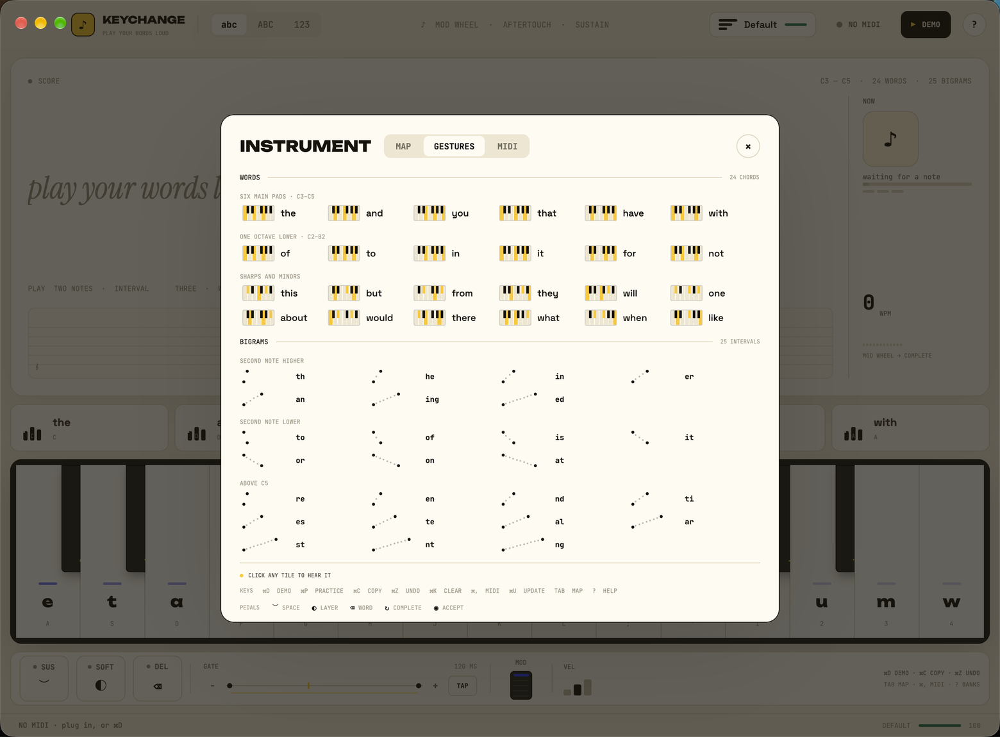
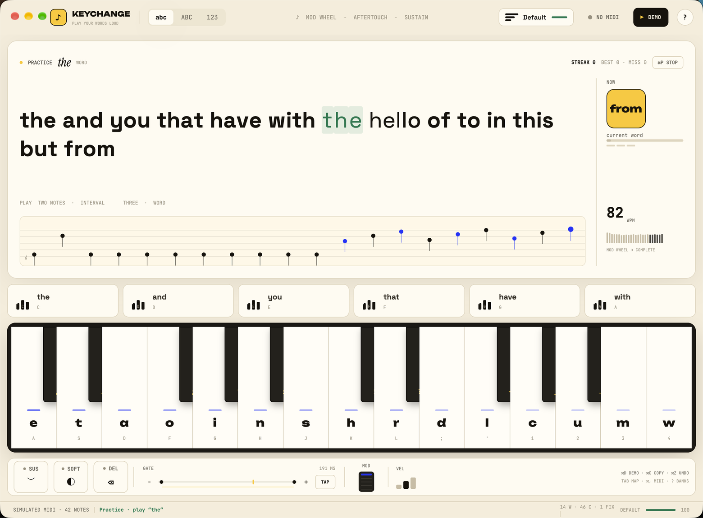
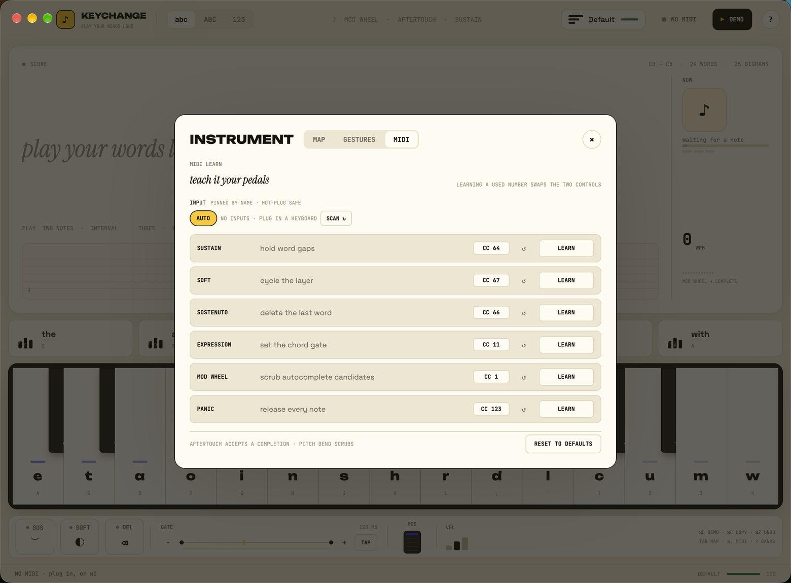
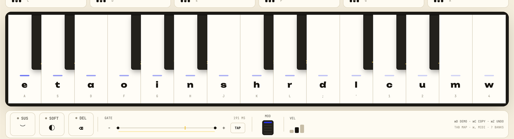

<p align="center">
  
</p>

<h1 align="center">KEYCHANGE</h1>

<p align="center">
  <strong>Play your words loud.</strong><br>
  Turn any MIDI piano into a keyboard.
</p>

<p align="center">
  <a href="https://github.com/Abhinav-Prabhakar/KeyChange/releases/latest"></a>
  
  
  
</p>

<p align="center">
  <a href="https://github.com/Abhinav-Prabhakar/KeyChange/releases/latest">
    
  </a>
</p>

<p align="center">
  <sub><b>3.4 MB</b> · macOS 14+ · Apple Silicon · no account · no subscription · no tracking</sub>
</p>

> **Typing was never meant to clack. It was meant to sing.** So we tuned every letter, gave punctuation rhythm, and turned QWERTY into an instrument. Every key types. Every chord shortcuts. Every song — a document.

**KeyChange** is a MIDI text instrument. Plug in a piano, play a letter, and watch it land in a live transcript. Hit a key harder and it gets **bolder**; tap soft and it turns *italic*. Sustain holds your spaces, three-note chords fire **24 common words**, two-note intervals type **25 bigrams**, and the staff snaps sloppy hands into perfect spelling.

It comes in two pieces: a **native macOS app** you can install in half a minute, and a **playable web page** that runs the same idea in your browser with no install at all.

---

## Install the app

1. **[Download the latest DMG →](https://github.com/Abhinav-Prabhakar/KeyChange/releases/latest)**
2. Open `KeyChange-*.dmg`.
3. Drag **KeyChange** into **Applications**.
4. Launch it. On first open, **right-click the app → Open** (see below).

Or let Homebrew do the same thing:

```bash
brew install --cask Abhinav-Prabhakar/tap/keychange
```

That's it. No installer wizard, no account, no background service. KeyChange is a single self-contained app that stores its settings in `~/Library/Application Support/KeyChange/`.

### About the first-launch warning

The build is **ad-hoc signed but not notarised** yet, so macOS shows a warning the first time. This is normal for an independent app:

- **Right-click KeyChange → Open**, then confirm **Open**; or
- open **System Settings → Privacy & Security** and choose **Open Anyway**.

You only do this once. A notarised, warning-free build is on the roadmap.

### Requirements

| | |
|---|---|
| **macOS** | 14 Sonoma or newer |
| **Processor** | Apple Silicon (M1 or later) |
| **Disk** | about 8 MB installed |
| **MIDI** | any class-compliant USB MIDI keyboard — no driver needed |
| **No piano?** | the built-in simulated player and computer keyboard both work |

Intel Macs and Windows/Linux are not packaged yet. The source builds with Cargo on any platform GPUI supports.

---

## Look around

### The whole instrument, one calm screen



Nothing is buried in a tab, a modal or a settings page. The transcript, staff, six word-chord pads, fifteen-key piano and the control deck are always on screen. The two reference cards are optional.

### Play it, or let it play itself


Press **⌘D** for a simulated performance. It sends real MIDI bytes through the exact same parser as a physical keyboard, so you can hear and see everything before plugging anything in.

### The map: why these letters?



Press **Tab**. Every key shows its letter frequency and its physical effort, scored `Σ frequency × effort`. Switch between **Default**, **Chromatic**, **Jazz**, **Coder** or your own layout, and compare the quality score against the theoretical optimum.

### Every gesture in one place



Press **?** for the cheat sheet: word chords, interval bigrams, and every shortcut in one card. Nothing to memorize, nothing to hunt for.

### Practice, audition, and stay current



Every tile in the gesture sheet is also a button: click a miniature keyboard or dot ruler and it plays that chord or bigram through the real engine, lighting the keys you would have pressed. Press **⌘P** when you want to be tested instead — KeyChange prompts a word or bigram, counts your streak, and flashes the right keys after a miss.

Click or drag the gate to set the chord window, or tap **TAP** a few times and let your own hands choose it. **⌘U** checks GitHub Releases, shows a version badge in the status bar, downloads the DMG, verifies its published checksum, and relaunches into the new build.

### Teach it your pedals



Press **⌘,**, choose a control, and move the pedal or knob. KeyChange captures its CC number instantly. Using a number that already belongs to another control swaps the two, so the map never ends up with two owners. Each row has its own **↺ reset**; **Reset to defaults** restores the whole map.

### The keyboard and deck, up close



Fifteen white keys carry the letters. Ten black keys carry punctuation. The deck holds sustain, soft, sostenuto, a 40–240 ms chord gate, a mod-wheel scrubber and base velocity. Heat under each key shows how often that letter appears in English.

---

## How to play

### On a MIDI keyboard

| Action | What it does |
|---|---|
| **Play a white key** | Types its letter |
| **Play it harder** | Soft = *italic*, medium = plain, hard = **bold**, hardest = highlight |
| **Play two notes upward** | Types a bigram: `th`, `he`, `in`, `er`, `an`, `ing`, `ed` |
| **Play two notes downward** | A second set: `to`, `of`, `is`, `it`, `or`, `on`, `at` |
| **Play two notes above C5** | Eleven more: `re`, `en`, `nd`, `ti`, `es`, `te`, `al`, `ar`, `st`, `nt`, `ng` |
| **Play three notes** | Types a whole word: `the`, `and`, `you`, `that`, `have`, `with`, plus 12 sharp/minor triads |
| **Play a pad below C3** | The same six shapes become a second bank: `of`, `to`, `in`, `it`, `for`, `not` |
| **Roll a chord** | Notes inside the gate window count as one chord; the gate is adjustable |
| **Hold sustain** | Holds the gap between words so you can type legato |
| **Tap soft** | Cycles the layer: `abc` → `ABC` → `123!?` |
| **Tap sostenuto** | Deletes the last word |
| **Move the mod wheel** | Scrubs autocomplete candidates |
| **Aftertouch** | Accepts the selected completion |
| **Pitch bend** | Scrubs candidates, like the wheel |
| **Panic** | Releases every held note |

### On a computer keyboard

No piano? The app is fully playable from the laptop.

| Key | Action |
|---|---|
| `A S D F G H J K L ;` | White keys |
| `W E T Y U` | Black keys (punctuation) |
| `Z` / `X` | Octave down / up |
| `Space` | Sustain — types a space |
| `Backspace` | Delete with a bend |
| `Tab` | Open / close the map |
| `?` | Open / close the gesture sheet |
| `⌘,` | Open / close MIDI Learn |
| `⌘P` | Start / stop practice |
| `⌘U` | Check for updates / install one |
| `⌘D` | Start / stop the simulated performance |
| `⌘C` | Copy the transcript |
| `⌘Z` | Undo |
| `⌘K` | Clear the score (undoable) |
| `Esc` | Close an overlay or cancel a remap |

### Three banks, one keyboard

The app uses the octaves a real piano already gives you:

- **Main word pads, C3–C5** — `the and you that have with`.
- **Low bank, C2–B2** — the same six triad shapes one octave lower type
  `of to in it for not`. A 49-key controller already covers this range.
- **Extra triads** — twelve sharp and minor shapes add `this but from they will
  one about would there what when like`.
- **Bigrams, three ways** — play the second note higher for the seven core
  bigrams, lower for another seven, and above C5 for eleven more. Direction is
  the whole trick: one interval, two words.

Press **?** any time to see every mapping, grouped by bank. The keyboard on
screen stays the same two octaves, so the instrument still fits in one calm
window; the extra keys are the ones already under your hands.

### The small things it does for you

- **Punctuation hugs the word.** A comma or full stop removes the space before it, so `hello ,` becomes `hello,`.
- **Sloppy spelling gets fixed.** `teh` becomes `the` as soon as the next note lands.
- **Stats are live.** The status bar counts words, characters and fixes for the current score.
- **Your setup survives.** Layouts, the active profile, layer, velocity, gate and learned CCs are saved and restored on launch.
- **The MIDI hover is a monitor.** Hover the MIDI status to see the last message, decoded: `NOTE C4 · 96`, `CC 64 · 127`, `BEND · 2048`.

---

## Profiles

Four layouts ship with the app:

| Profile | Idea |
|---|---|
| **Default** | Huffman-optimal English — the most common letters under the easiest keys |
| **Chromatic** | Letters in scale order, for musicians who think in pitch |
| **Jazz** | Seven, nine, sharps and flats where the music lives |
| **Coder** | Brackets, semicolons and symbols under the fingers |

Duplicate any layout into a custom profile, then **Remap** by clicking two white keys to swap them. The quality score updates live. Custom layouts are saved between launches.

---

## The web toy

The same idea runs in the browser — no install, no build step, no account.

<a href="https://abhinav-prabhakar.github.io/KeyChange/">
  
</a>

<p align="center"><sub><a href="https://abhinav-prabhakar.github.io/KeyChange/"><b>▶ Open the live stage</b></a> · plug in a keyboard, click a key, or type A–K.</sub></p>

<table>
<tr>
<td width="50%">
  
  <br><sub><b>A real sampler.</b> Salamander Grand Piano samples, velocity-shaped filters and a convolution room.</sub>
</td>
<td width="50%">
  
  <br><sub><b>See your typing.</b> Every keystroke becomes a note block, with EQ and waveform.</sub>
</td>
</tr>
<tr>
<td>
  
  <br><sub><b>Six pedals, six ideas.</b> Staff to page, velocity to emphasis, sustain to space, quantize to autocorrect.</sub>
</td>
<td>
  
  <br><sub><b>Chords as shortcuts.</b> Hold three keys for copy, paste, save or undo.</sub>
</td>
</tr>
<tr>
<td>
  
  <br><sub><b>Four hands.</b> Flip a record, flip the layout.</sub>
</td>
<td>
  
  <br><sub><b>Perfect spelling.</b> Watch sloppy hands snap into whole words.</sub>
</td>
</tr>
</table>

The page is semantic HTML, hand-written CSS and vanilla JavaScript: Canvas 2D, Web Audio, Web MIDI, no framework and no tracker. Real MIDI needs Chrome or Edge over HTTPS; the on-screen piano and A–K work everywhere.

---

## Build it yourself

```bash
git clone https://github.com/Abhinav-Prabhakar/KeyChange.git
cd KeyChange/app

cargo run          # development build
make app           # KeyChange.app in app/dist/
make dmg           # KeyChange-<version>.dmg in app/dist/
make icon          # re-render assets/AppIcon.icns from icon.svg
cargo test         # 64 tests
```

`cargo run` is the fastest loop. The bundle adds the app icon, the proper name in the menu bar, and a stable settings location. `KC_DEMO=1 cargo run` starts the simulated performance immediately.

For the web page:

```bash
python3 -m http.server 8099
# then open http://localhost:8099
```

### Under the hood

- **Rust + [GPUI](https://gpui.rs)** — the renderer behind Zed. One native window, no WebView, no Electron.
- **[midir](https://github.com/Boddlnagg/midir)** — raw MIDI I/O with a reconnecting device hub.
- **Serde + JSON** — settings in `~/Library/Application Support/KeyChange/settings.json` (XDG paths elsewhere), written atomically, with corrupt files moved aside instead of blocking launch.
- **64 unit tests** — velocity buckets, chord timing, interval and octave gestures, sustain gaps, quantize and candidate acceptance, WPM, undo/delete, profile scoring and remapping, CC routing and learning, settings round-trips and repair, MIDI byte parsing and the demo script.

Read [`app/README.md`](app/README.md) for the architecture, the full gesture map and the design notes.

---

## Release notes

Every download lives on **[GitHub Releases](https://github.com/Abhinav-Prabhakar/KeyChange/releases)**. The current build is **0.5.0**; the full history is in [`CHANGELOG.md`](CHANGELOG.md).

---

## License

MIT. The piano samples on the web page are the **Salamander Grand Piano V3** (CC BY 3.0); bundled fonts are SIL OFL. See [`LICENSE`](LICENSE).

<p align="center">
  
  <br>
  <sub><b>© 2026 KEYCHANGE — PLAY YOUR WORDS</b><br>
  Made at 440Hz · <i>ppp → fff</i> · zero clack · MIT</sub>
</p>
