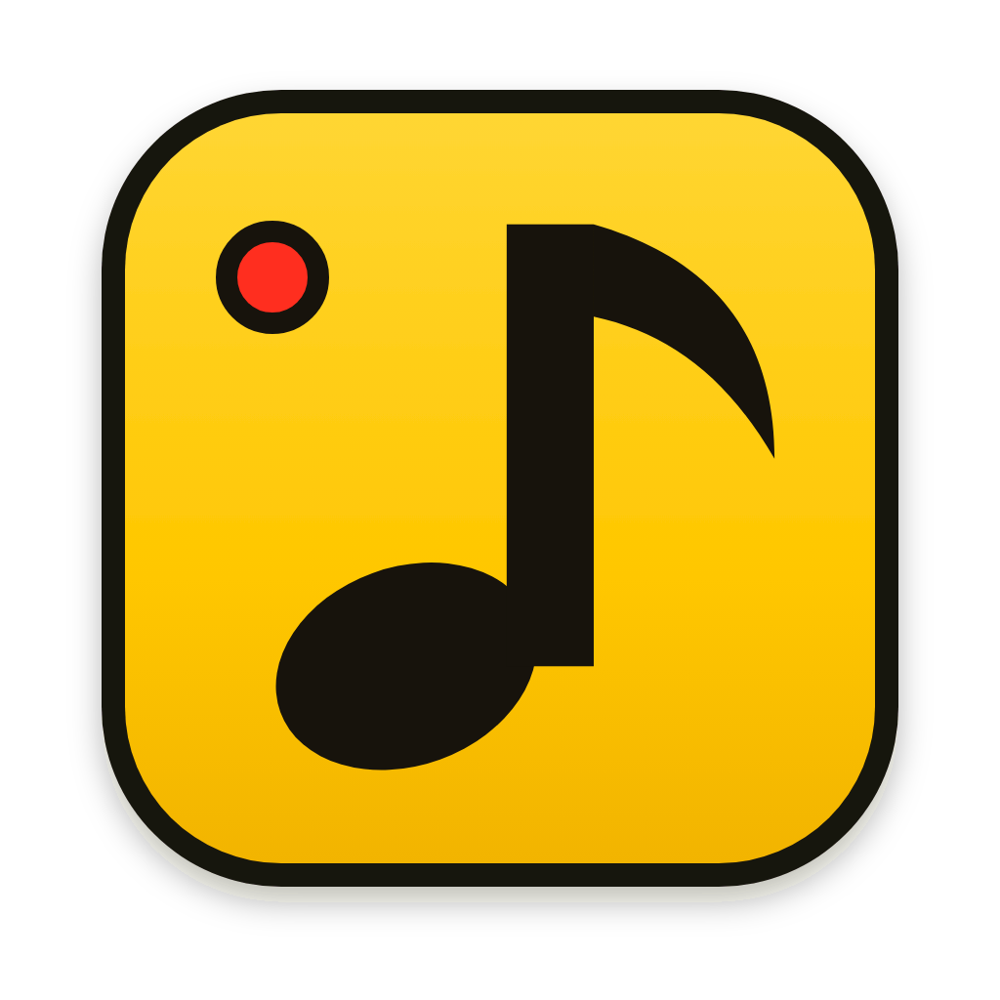
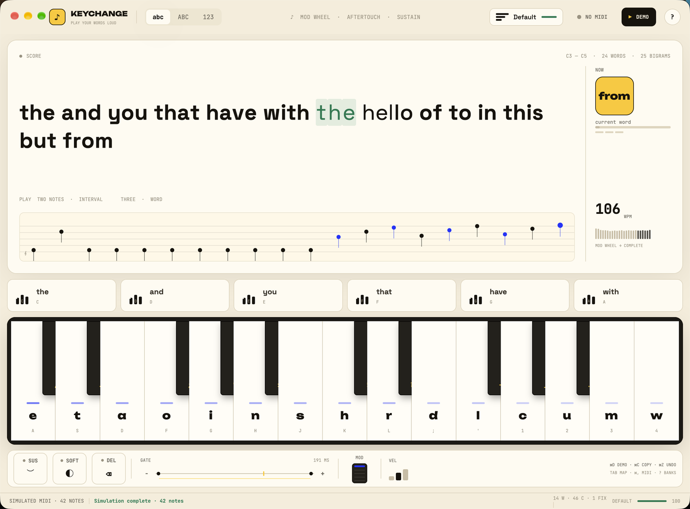
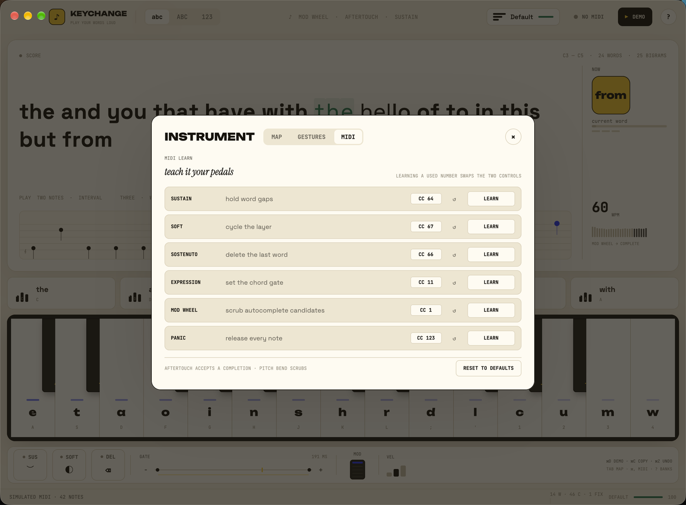

<p align="center">
  
</p>

# KeyChange for the desktop

A native MIDI text instrument in one window. Plug in a piano, play a letter, and
watch it land in a live score. Loud notes come out **bold**, soft notes come out
*italic*, chords fire **24 common words**, intervals type **25 bigrams**, and the
staff snaps sloppy hands into perfect spelling.

Built in Rust with [GPUI](https://gpui.rs) (the renderer behind Zed) and
[`midir`](https://github.com/Boddlnagg/midir) for MIDI I/O. No browser, no build
step, no account.



## Install it

**Download** the latest DMG from
**[GitHub Releases](https://github.com/Abhinav-Prabhakar/KeyChange/releases/latest)**,
open it, and drag **KeyChange** into Applications. It is 3.4 MB, macOS 14+ on
Apple Silicon.

The build is ad-hoc signed but not notarised yet, so the first launch needs
right-click → **Open** (or System Settings → Privacy & Security → **Open Anyway**).

### Build from source

```bash
cd app
cargo run          # development build
make app           # KeyChange.app in app/dist/
make dmg           # KeyChange-<version>.dmg in app/dist/
```

`cargo run` is the fastest loop. The bundle adds the icon, the proper app name
in the menu bar, and a stable settings location.

Press **⌘D** (or click **DEMO**) to hear the instrument play itself. The
simulated player emits real MIDI bytes through the same parser as hardware, so
you can evaluate everything without a piano plugged in. **KC_DEMO=1 cargo run**
starts the simulation on launch.

macOS 14+ is the current target; GPUI builds on Linux and Windows too but only
macOS has been exercised here.

## The whole instrument, one screen

Everything is always visible. Nothing is a tab, a modal, or a settings page —
the three overlays (**Tab** for the map, **?** for gestures, **⌘,** for MIDI
Learn) are reference cards, not required steps.

| Region | What it does |
|---|---|
| **Toolbar** | Layer switch (`abc / ABC / 123`), live CC lights, profile picker, MIDI status, demo, shortcuts. |
| **Overlays** | **Tab** — the Huffman map. **?** — gestures and shortcuts. **⌘,** — MIDI Learn. |
| **Score** | The transcript, a 20-note staff, and the right rail: NOW (note / interval / chord), WPM and a wheel history. Hover any key or pad to reveal numbers in the rail. |
| **Chord pads** | Six triads — `the and you that have with` — each showing its three keys and its share of English. Click or play them. |
| **Keyboard** | Fifteen white keys (Huffman letters) and ten black keys (punctuation), with heat strips, live held-note rings and per-key velocity. The drawn two octaves are the main bank; the rest of your controller reaches the low and high banks. |
| **Deck** | Sustain / soft / sostenuto pedals, a 40–240 ms gate slider, mod-wheel scrubber and base velocity. |
| **Status bar** | MIDI state (`MIDI LIVE`, `SIMULATED MIDI · n NOTES`, `NO MIDI`), notice line, live word / character / fix counts and profile quality. |

## Playing it

### On a MIDI keyboard

| Gesture | Result |
|---|---|
| One key | Letter (or punctuation on a black key) |
| Key in another octave | Same letter — octaves are free |
| Three notes (a pad triad) | Whole word: `the`, `and`, `you`, `that`, `have`, `with` |
| The same triad below C3 | The low bank: `of`, `to`, `in`, `it`, `for`, `not` |
| A sharp or minor triad | One of twelve more words: `this but from they will one about would there what when like` |
| Two notes going up, 1–9 semitones | Bigram: `th`, `he`, `in`, `er`, `an`, `ing`, `ed` |
| Two notes going down, same intervals | A second set: `to`, `of`, `is`, `it`, `or`, `on`, `at` |
| Two notes above C5 | Eleven more: `re`, `en`, `nd`, `ti`, `es`, `te`, `al`, `ar`, `st`, `nt`, `ng` |
| Two notes, an octave apart | Repeat the last completed word |
| Sustain (CC64) | Word gaps — spaces follow legato |
| Soft (CC67) | Cycle to the next layer |
| Sostenuto (CC66) | Delete the last word (an undo pedal) |
| Mod wheel (CC1) | Scrub autocomplete candidates |
| Aftertouch | Accept the selected candidate |
| Expression (CC11) | Set the chord gate, 40–240 ms |

Chord detection is purely time-based: notes inside the gate window (default
120 ms) form a gesture, and separate gestures type separate letters. That makes
the instrument forgiving of rolled chords without ever swallowing a fast run.

### Three banks, one keyboard

The app uses the octaves a real piano already gives you. The screen keeps the
same fifteen white keys and ten black keys, so nothing gets more crowded; the
extra mappings live on keys your controller already has.

| Bank | Where | What you get |
|---|---|---|
| **Main words** | C3–C5, the drawn keyboard | Six triads: `the and you that have with` |
| **Low words** | C2–B2, below the drawn keyboard | The same six shapes: `of to in it for not` |
| **Extra words** | Any octave, triads with a black key | Twelve sharp and minor triads: `this but from they will one about would there what when like` |
| **Up bigrams** | Two notes, second higher | `th he in er an ing ed` |
| **Down bigrams** | Two notes, second lower | `to of is it or on at` |
| **High bigrams** | Two notes, both above C5 | `re en nd ti es te al ar st nt ng` |

Direction is the trick for intervals: the same two keys are two different
bigrams depending on which note you play second. The high bank is the only place
a black key can start a two-note gesture, so it never fights the punctuation
keys. Low-bank chords are recognised by their lowest note, which lets the
F, G and A shapes reach up past C3 without losing their second meaning.

### On a computer keyboard

| Keys | Action |
|---|---|
| `A S D F G H J K L ; ' 1 2 3 4` | The fifteen white keys |
| `W E T Y U O P [ ] \` | The ten black keys |
| `Space` | Commit a space (sustain-style) |
| `Enter` | Commit the trailing word |
| `↑ / ↓` | Scrub autocomplete candidates |
| `← / →` or `[ / ]` | Previous / next layer |
| `⌫` | Delete a character |
| `Esc` | Close the overlay or cancel remapping |
| `Tab` | Toggle the map overlay |
| `?` or `/` | Toggle the gesture reference |
| `⌘D` | Start / stop the simulated performance |
| `⌘,` | Open / close MIDI Learn |
| `⌘C` | Copy the transcript |
| `⌘Z` | Undo the last edit |
| `⌘K` | Clear the score (undoable with `⌘Z`) |
| `⌘Q` | Quit |

Clicking a key plays it — click high for a soft note, low for a hard one. Pad
and pedal clicks are the same messages the hardware sends.

## The small things it does for you

- **Punctuation hugs the word.** A comma, full stop or question mark removes the
  space before it, so `hello ,` becomes `hello,` the moment the key lands.
- **Clear is undoable.** `⌘K` still wipes the score, but `⌘Z` brings it back.
- **Live session stats.** The status bar counts words, characters and
  corrections for the current score, and clears when the score does.
- **MIDI monitor.** Hover the MIDI status to see the last message decoded:
  `NOTE C4 · 96`, `CC 64 · 127`, `AT · 80`, `BEND · 2048`.
- **First-run tip.** A new install shows a single hint in the status bar:
  `First time? ⌘D plays it · Tab opens the map`. It disappears as you play.
- **Per-control reset.** Each MIDI Learn row has its own **↺** button. Reset one
  pedal without disturbing the rest of the map.

## Profiles

Four layouts ship: **Default** (Huffman-optimal English), **Chromatic**, **Jazz**
and **Coder**. Open **Tab** to see the letter-frequency map with each key's
effort, and a live quality score. **Duplicate** clones the active layout into a
custom profile; **Remap** swaps two white keys by clicking their columns. Score
is `Σ frequency × effort`, so layouts can be compared against the optimum.

Layouts, the active profile, layer, velocity, gate and learned CCs are saved to
`~/Library/Application Support/KeyChange/settings.json` (XDG paths on Linux) and
restored on launch. A corrupt file is moved aside rather than blocking startup.

## MIDI Learn

Open **⌘,**. Every control the app listens for is listed with its current CC:



| Control | Default | What it does |
|---|---|---|
| Sustain | 64 | Hold word gaps |
| Soft | 67 | Cycle the layer |
| Sostenuto | 66 | Delete the last word |
| Expression | 11 | Set the gate, 40–240 ms |
| Mod wheel | 1 | Scrub completions |
| Panic | 123 | Release every note |

Hit **LEARN**, move the pedal or knob, and the number is captured. Learning a
number that already belongs to another control swaps the two, so the map never
ends up with two owners for one knob. The **↺** beside each row restores just
that control; **RESET TO DEFAULTS** restores the spec numbers. Aftertouch is
fixed to *accept completion*; pitch bend always scrubs.

## How it is built

```text
app/
├── src/
│   ├── main.rs      Window, bundled fonts, focus, KC_DEMO.
│   ├── engine.rs    Pure state machine: notes, gestures, layers, pedals,
│   │                candidates, WPM, profiles, undo. No GPUI, no threads.
│   ├── midi.rs      Raw byte parser, MidiHub with reconnecting hardware input,
│   │                and the simulated player. Hardware and demo share a path.
│   └── ui.rs        The single-screen GPUI view, overlays and all interactions.
├── assets/          App icon (SVG + ICNS), fonts (OFL, licences included).
├── scripts/         bundle.sh, dmg.sh, make-icon.sh.
├── Info.plist       Bundle identity, version, icon, macOS metadata.
└── Cargo.toml
```

The engine never knows where a note came from. `midi::parse` turns raw bytes
into `MidiMsg`s, `Engine` turns messages into text, and `ui.rs` only draws and
forwards input. That split is what makes an interaction testable without a
window.

Fonts are bundled so the instrument looks the same on a fresh machine; there is
no font dependency on the OS.

## Tests

```bash
cargo test
```

63 tests cover the parts that are easy to break: velocity buckets, layer
precision, chord timing, interval and octave gestures, every word and bigram
bank, sustain gaps, quantize and candidate acceptance, WPM, undo/delete, profile
scoring and remapping, CC routing and learning, settings round-trips and repair,
MIDI byte parsing, and the demo script. The UI is verified by screenshot, not by
unit test.

## Known rough edges

- The macOS build is ad-hoc signed, not notarised. First launch needs
  right-click → **Open**.
- Linux and Windows builds are untested; the app currently targets macOS.
- The simulation is a fixed script, not a generative player.
- There is no per-key character picker yet — MIDI Learn reprograms controls,
  not letters.

---

<p align="center"><sub>The design system behind this screen lives in <a href="../design.md">design.md</a>.<br>
The playable landing page lives at <a href="https://abhinav-prabhakar.github.io/KeyChange/">abhinav-prabhakar.github.io/KeyChange</a>.</sub></p>
